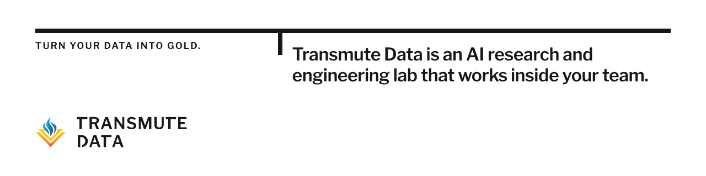

<picture>
  <source media="(prefers-color-scheme: dark)" srcset="assets/banner-dark.png">
  
</picture>

# Transmute Data

**Industry-leading data scientists, AI engineers, and researchers, forward-deployed into your team.**

Transmute Data is an AI research and engineering lab that works inside your team: senior consultants in your repositories, your environments, and your stand-ups, by the hour or under a scoped statement of work. They hand over a working system your team builds upon.

### Where we work

- **GPU infrastructure.** Observability for GPU infrastructure, built end to end.
- **Healthcare data.** Inside your governed environment, by the hour or by SOW.
- **Research and deep tech.** Quantum, HPC, and life-science researchers who also write the code.
- **And more.** Agentic systems, financial services, platform integrity, the electric grid, defense and autonomy, enterprise security, and consumer product engineering.

### How we work

- **12 senior data scientists, AI engineers, and researchers**, averaging 15+ years each.
- **Forward-deployed consulting**, by the hour or by SOW.
- **Handover is in scope.** Agents and harnesses built for you, documentation, runbooks, the evaluation set, and monitoring. You own the deliverables once they're paid for. We keep the tools and frameworks we brought with us.
- **We never train on your data, and never on PHI.** We hold no HIPAA attestation of our own — we work inside your governed environment, under your BAA.

### What's here

What we publish openly will appear here. Client work stays in client repositories.

---

[transmutedata.com](https://transmutedata.com) · Start with a 30-minute call on one problem you name.

© 2026 Data Mages LLC d/b/a Transmute® Data
